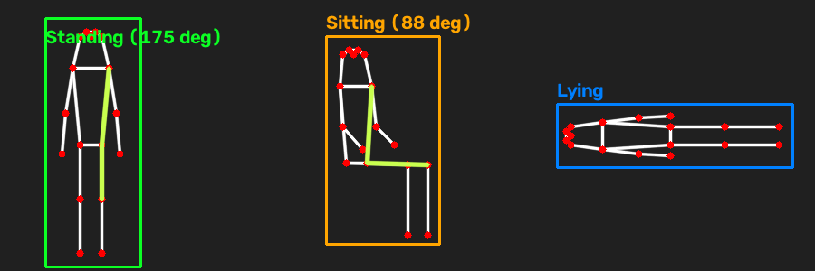
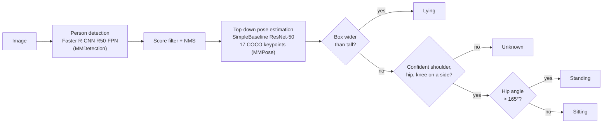

# Pose-Based Posture Classifier

**Standing, sitting or lying? A two-stage computer-vision pipeline that detects people, estimates their 2D skeleton, and classifies posture with transparent, testable geometric rules.**

[](https://github.com/<your-username>/pose-posture-classifier/actions/workflows/ci.yml)



<sub>The three rules applied to hand-made skeletons (rendered by `scripts/make_rule_figure.py`). These are illustrations, not model predictions.</sub>

---

## Why

Knowing whether a person is standing, sitting or lying is a building block for fall detection in elderly care, ergonomics monitoring, occupancy analytics and human-aware robotics. End-to-end action classifiers need labelled data and are hard to inspect. This project takes the opposite approach: reuse strong pretrained pose models and put a small, explainable decision layer on top that you can read, unit-test and tune in a YAML file.

## What it does



**Key features**

- Multi-person: every detected person is classified, not just one.
- Facing-invariant hip angle (interior shoulder–hip–knee angle, 0–180°).
- Automatic body-side selection: uses whichever side's keypoints are most confident, so an occluded right leg doesn't produce a confident wrong answer.
- Explicit `Unknown` label instead of guessing from low-confidence keypoints.
- Single YAML config for models, thresholds and drawing; CLI for images or folders; JSON output for downstream use.
- Core logic is pure NumPy and fully unit-tested on CPU; the deep-learning models are loaded lazily, so CI needs no GPU or model downloads.

## Tech stack

Python · PyTorch · MMDetection 3.x · MMPose 1.x · MMEngine/MMCV · OpenCV · NumPy · pytest · Ruff · GitHub Actions

## Models and data

No training is involved and no dataset is shipped. Both models are pretrained on [COCO](https://cocodataset.org/) and published by OpenMMLab under Apache-2.0. They are downloaded on demand and are git-ignored.

| Stage | Model | Accuracy reported by OpenMMLab (COCO val) |
|---|---|---|
| Person detection | Faster R-CNN R50-FPN, 1x schedule | 37.4 box AP (all classes) |
| Pose estimation | SimpleBaseline ResNet-50, 256×192 input | 0.718 keypoint AP |

These numbers come from the OpenMMLab model zoo metadata and were **not reproduced** in this project. COCO images carry their own licenses (mostly Creative Commons via Flickr); see the COCO terms of use.

## Installation

The posture logic only needs NumPy, OpenCV and PyYAML. Running the actual models needs the OpenMMLab stack, whose `mmcv` package ships pre-built wheels only for specific PyTorch/CUDA/Python combinations. Python 3.10 with PyTorch 2.1 is a combination that has wheels.

```bash
git clone https://github.com/<your-username>/pose-posture-classifier.git
cd pose-posture-classifier

# 1. Environment (conda shown; venv works too)
conda create -n posture python=3.10 -y
conda activate posture

# 2. PyTorch: pick ONE line
pip install torch==2.1.2 torchvision==0.16.2 --index-url https://download.pytorch.org/whl/cu121  # NVIDIA GPU
pip install torch==2.1.2 torchvision==0.16.2 --index-url https://download.pytorch.org/whl/cpu    # CPU only

# 3. OpenMMLab stack (mim picks the mmcv wheel that matches your torch build)
pip install -U openmim
mim install -r requirements-mmlab.txt

# 4. This package (+ dev tools)
pip install -e ".[dev]"

# 5. Model configs and weights -> ./checkpoints (about 0.3 GB)
bash scripts/download_models.sh
```

Only want to run the tests or work on the rules? Steps 1 and 4 are enough.

**Hardware.** A CUDA GPU is recommended for videos or large batches. Single images also run on CPU, just more slowly; inference speed has not been benchmarked here. No step requires a GPU.

## Quick start

```bash
# One image or a whole folder; annotated images + results.json go to outputs/
posture-classify --input path/to/photo.jpg
posture-classify --input path/to/folder --output-dir outputs --device cpu

# Skip the detector and supply a person box yourself (repeatable)
posture-classify --input photo.jpg --bbox 737 453 879 716
```

Example `results.json` entry (structure; values depend on your image):

```json
{
  "photo.jpg": [
    {
      "bbox_xyxy": [737.2, 453.8, 879.9, 716.9],
      "bbox_score": 0.986,
      "posture": "Standing",
      "hip_angle_deg": 172.4,
      "side": "left",
      "reason": "hip angle 172.4 > 165"
    }
  ]
}
```

Python API:

```python
import cv2
from posture_classifier.config import load_config
from posture_classifier.pipeline import PosturePipeline

config = load_config("configs/default.yaml")
pipeline = PosturePipeline.from_config(config)
for person in pipeline(cv2.imread("photo.jpg")):
    print(person.posture.posture.value, person.posture.hip_angle)
```

A walkthrough is in [`notebooks/posture_demo.ipynb`](notebooks/posture_demo.ipynb).

## Configuration

Everything tunable is in [`configs/default.yaml`](configs/default.yaml):

| Key | Default | Meaning |
|---|---|---|
| `device` | `auto` | `cuda:0` if available, else `cpu` |
| `detector.score_threshold` / `nms_threshold` | 0.3 / 0.3 | Person-box filtering |
| `posture.standing_min_angle` | 165 | Hip angle (°) above which an upright person is "Standing" |
| `posture.min_keypoint_score` | 0.3 | Below this a keypoint is not trusted |
| `posture.side` | `auto` | `auto`, `right` or `left` (`right` = original notebook behaviour) |

## Results

There are no quantitative results yet. The rules have **not** been evaluated on a labelled posture dataset, and the original notebook never ran to completion (see [project history](#project-history)), so there are no earlier outputs to report either. What is verified is the behaviour of the code: 40 unit tests cover the geometry, rules, configuration, detection filtering, visualization and CLI.

A natural next step is to evaluate on a public dataset with posture or fall labels and report per-class precision and recall.

## Project structure

```text
pose-posture-classifier/
├── configs/default.yaml          # models, thresholds, drawing options
├── docs/posture_rules.png        # figure used above
├── notebooks/
│   ├── posture_demo.ipynb        # clean walkthrough using the package
│   └── original_colab_notebook.ipynb  # untouched original, for reference
├── scripts/
│   ├── download_models.sh        # fetch configs + weights via mim
│   └── make_rule_figure.py       # regenerate docs/posture_rules.png
├── src/posture_classifier/
│   ├── keypoints.py              # COCO-17 names, skeleton, body sides
│   ├── geometry.py               # angles, box size
│   ├── posture.py                # the classification rules
│   ├── config.py                 # typed, validated YAML config
│   ├── pipeline.py               # detector + pose model + NMS (lazy MMLab imports)
│   ├── visualization.py          # OpenCV drawing
│   └── cli.py                    # `posture-classify` entry point
├── tests/                        # pytest suite, no models or GPU needed
├── pyproject.toml                # packaging, Ruff and pytest config
├── requirements*.txt
└── .github/workflows/ci.yml      # Ruff + pytest on Python 3.10–3.12
```

## Design decisions

- **Rules on top of pretrained models, not a new classifier.** No labelled posture data was available, and the rules are inspectable and easy to adjust. The trade-off is lower robustness than a learned classifier.
- **Hip angle (shoulder–hip–knee).** Hip flexion separates standing (~180°) from sitting (~90°) better than any single keypoint position, and it does not depend on image scale.
- **Interior instead of directional angle.** The original directional angle (0–360°) gave different answers for the same posture depending on which way the person faced. The interior angle removes that dependence.
- **Lazy OpenMMLab imports and pure functions.** Anything that can be tested without a GPU is a plain NumPy function, and the model wrapper is thin. CI therefore runs in seconds without downloading weights.
- **Weights fetched with `mim`, never committed.** The repository stays small and the provenance of the weights stays clear.
- **No random seeds.** The pipeline only runs inference with fixed weights, so there is no randomness to seed. GPU results may still differ in the last decimals across hardware and library versions.

## Known limitations

- The rules are heuristics and have not been evaluated (see [Results](#results)).
- The aspect-ratio test for "Lying" fails for people lying along the camera's line of sight, and can fire for standing people with arms spread wide.
- A 2D angle under strong perspective is unreliable. For example, a seated person facing the camera can project to a straight-looking hip angle.
- Squatting, kneeling and bending are not modelled and fall into "Sitting" or "Standing".
- Pre-built `mmcv` wheels lag behind new PyTorch and Python releases. On recent Colab runtimes you may need to install a matching PyTorch version or build `mmcv` from source.

**Possible improvements:** evaluate on a labelled dataset, add temporal smoothing for video, use torso orientation relative to the ground instead of the box aspect ratio, replace the rules with a small classifier trained on keypoint features, and try faster models (RTMDet + RTMPose) for real-time use.

## Project history

This repository grew out of a Google Colab prototype, kept unchanged in [`notebooks/original_colab_notebook.ipynb`](notebooks/original_colab_notebook.ipynb). The refactor fixed these issues:

| Original behaviour | Fix |
|---|---|
| Used the MMPose 0.x API with MMPose 1.3 installed → `ImportError`; the notebook never produced output | Ported to the MMPose 1.x / MMDetection 3.x APIs |
| Detector output overwritten by a hard-coded box; only the first person used | Real detections, score filter, NMS, every person classified |
| Comment said "right ankle" but index 14 is the **right knee** | Kept the knee (the computed behaviour) and fixed the naming |
| Directional angle with an asymmetric 165–200° window, so the label depended on facing direction | Interior angle with a single threshold (165°) |
| Right side only, keypoint confidence ignored | Most confident side, plus an `Unknown` label |
| Colab-only display, hard-coded `/content/...` paths, label could be drawn above the image | CLI + config, portable paths, label kept inside the image |

## Acknowledgements and citation

Built on [MMPose](https://github.com/open-mmlab/mmpose) and [MMDetection](https://github.com/open-mmlab/mmdetection) by OpenMMLab (Apache-2.0). If you use the models, please cite:

```bibtex
@misc{mmpose2020,
  title  = {OpenMMLab Pose Estimation Toolbox and Benchmark},
  author = {MMPose Contributors},
  howpublished = {\url{https://github.com/open-mmlab/mmpose}},
  year   = {2020}
}
@article{mmdetection,
  title   = {{MMDetection}: Open MMLab Detection Toolbox and Benchmark},
  author  = {Chen, Kai and others},
  journal = {arXiv preprint arXiv:1906.07155},
  year    = {2019}
}
@inproceedings{xiao2018simple,
  title     = {Simple Baselines for Human Pose Estimation and Tracking},
  author    = {Xiao, Bin and Wu, Haiping and Wei, Yichen},
  booktitle = {ECCV},
  year      = {2018}
}
```

## License

The code in this repository is released under the [MIT License](LICENSE). The pretrained weights and the OpenMMLab libraries keep their own Apache-2.0 license, and COCO-derived assets follow the COCO terms.
